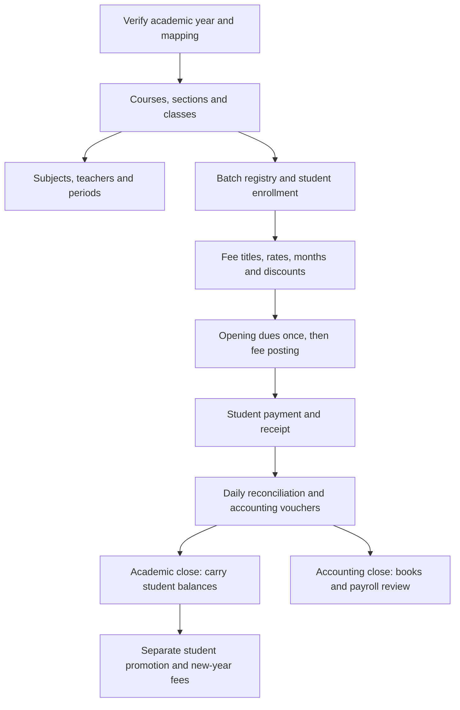

# SchoolCore user manual: academics, billing and year closing

Reviewed against the repository on 31 October 2026. This describes the checked-in implementation; it does not certify the version deployed at a school or its live balances. Menu visibility depends on role, permissions and enabled modules. Names below use the existing functional menu names; a school theme may shorten the labels.

Start with the setup checklist, then follow the numbered tasks. Each task tells you where to go, what to do and what to verify. The in-app **Guides** page contains the same core instructions plus attendance, exams, communications and library help.

## The whole workflow

College continuing cohorts need a planned rollover; the ordinary academic close can block while juniors are still running. Do not treat this diagram as permission to bypass that check.

## Quick dictionary

| Term                      | Plain meaning                                    | Example                         |
| ------------------------- | ------------------------------------------------ | ------------------------------- |
| Academic year             | The session a class group operates in            | SCHOOL 2083                     |
| Mapping                   | Which academic year a class group currently uses | Grade Eleven → its running year |
| Class                     | Grade or course level, optionally with a section | Class Two A; BCA Semester 1     |
| Section                   | A division within a class                        | A, B                            |
| Course                    | A program, or a +2 stream under a faculty        | BCA; a Management stream        |
| Subject                   | An item taught and examined within a class       | English                         |
| Period                    | A numbered subject/teacher slot                  | Period 1                        |
| Batch                     | The original college intake identity             | Admission batch 2082            |
| Fee title                 | What the charge is for                           | Tuition                         |
| Fee rate                  | The class amount for that title                  | Rs 2,000 per payable month      |
| Posting / student ledger  | A charge recorded against a student              | Two months of tuition           |
| Student invoice / receipt | A record of money received                       | Rs 3,000 received               |
| Reminder bill             | A statement asking for payment                   | Rs 1,800 still due              |
| Accounting ledger         | A general-ledger account                         | Cash in Hand                    |
| Accounting voucher        | An income, expense or journal entry              | Office expense payment          |

## Choose your task

1. [Start here: school setup in the right order](#task-1)
2. [Understand the three kinds of year](#task-2)
3. [Create sections and classes](#task-3)
4. [Set up courses and classwise subjects](#task-4)
5. [Assign subjects and teachers to periods](#task-5)
6. [Manage a college intake or batch](#task-6)
7. [Enroll a new student](#task-7)
8. [Set fee titles, amounts and payable months](#task-8)
9. [Enter opening dues from the previous register](#task-9)
10. [Post fees: create the amount students owe](#task-10)
11. [Collect a fee and print the receipt](#task-11)
12. [Choose student payment, cash receipt or Extra Billing](#task-12)
13. [Send home a dues reminder bill](#task-13)
14. [Find out who still owes money](#task-14)
15. [Balance the counter at the end of the day](#task-15)
16. [Bill non-student parties such as tenants](#task-16)
17. [Record income, expenses and adjustments](#task-17)
18. [Check the books before closing](#task-18)
19. [Close the academic year and carry student dues](#task-19)
20. [Promote students or change their section](#task-20)
21. [Close the accounting year and review payroll carry](#task-21)
22. [Required product improvements and release checks](#required-improvements)

## 1. Start here: school setup in the right order

Complete this checklist before enrolling and billing students.

**Open:** Manage (`/admin/manage/academic-year`). Staff should use the same page under their own portal.

1. Open Manage ▸ Academic Year and check the running year. This list is read-only; support sets up the first year. Later years are created by Academic Year Closing.
2. Add courses or +2 streams under Courses/Subjects ▸ Course Setup. Set the faculty for a +2 stream and program length for a college course.
3. Check Academic Year Mapping for each level, grade or course/year/semester. Save the intended mapping and reload. Ask support to correct an existing year mismatch before billing.
4. Add section names under Sections. Under Classes/Periods, create the base class first, then its section classes, such as Class Two, Class Two A and Class Two B.
5. Add classwise subjects under Courses/Subjects. Enroll teachers, then assign subjects and teachers to periods under Classes/Periods.
6. For college intakes, register batches under Batches. Creating a batch alone does not assign students or classes.
7. Set fee titles, class amounts and payable months under Fees. Enroll students in the correct class; review their discounts and transport details.
8. Enter verified opening dues once, post applicable fees, then check one student ledger before collecting payments.

**Remember:**

- Academic year closing updates existing classes; do not recreate every class each year.
- Setting a fee rate does not charge a student. Ledger Posting creates the charge; Student Payment records money received.

## 2. Understand the three kinds of year

Academic year, billing economic year and accounting economic year have different jobs.

**Open:** Manage ▸ Academic Year (`/admin/manage/academic-year`). Staff should use the same page under their own portal.

1. Use the academic year for class operation, student charges, payments and results.
2. Use Academic Year Mapping to check which year each class group operates in. The page year selector alone does not determine every class year.
3. Check the billing economic year on receipts and collection reports. Student, cash and Extra Billing receipts share numbering within the school and this fiscal year.
4. Use Accounting ▸ Economic Year for vouchers and accounting reports. It is a separate record from the student academic year.
5. Use Academic Year Closing to carry student balances; use Accounting Economic Year Closing to close the books. Review payroll carry in the accounting close result.

**Remember:**

- Closing an academic year does not restart receipt numbers within the same billing fiscal year.
- Use B.S. dates where the form requests them. Check the actual final day of the month.

## 3. Create sections and classes

A section name and a class using that section are separate setup steps.

**Open:** Manage ▸ Classes/Periods (`/admin/manage/classes`). Staff should use the same page under their own portal.

1. Open Manage ▸ Sections and add names such as A and B once.
2. Open Classes/Periods. Choose the education level and grade, or the course and year/semester.
3. Create the base class without a section and verify its academic year.
4. Create each required section class, for example Class Two A and Class Two B.
5. Reopen the class picker and confirm the class/section appears before enrolling students.

**Remember:**

- For +2, a faculty or course/stream is not the same thing as section A/B.
- If a class is missing, check its year mapping, education level and actual section assignment.

## 4. Set up courses and classwise subjects

A course is a program or stream; a subject is something taught within it.

**Open:** Manage ▸ Courses/Subjects (`/admin/manage/courses-subjects`). Staff should use the same page under their own portal.

1. In Course Setup, enter the course name and education level. For +2 select its faculty.
2. For a college program, set its total years or total semesters according to its structure.
3. Create its classes in Classes/Periods if they do not exist.
4. Open Classwise Subject Setup and select the intended class.
5. Enter the subject name, code, compulsory/optional type, order and credit hours. Add practical details where applicable, then save.
6. For optional subjects, use Exam and result ▸ Optional Subject Assignment to select the students taking each subject.
7. Check the subject list for that class before setting periods or entering marks.

**Remember:**

- A subject already used or marked protected cannot simply be deleted.
- Correct program length helps the closing check distinguish continuing students from final-year students.

## 5. Assign subjects and teachers to periods

Set up the period slots for a class.

**Open:** Manage ▸ Classes/Periods (`/admin/manage/classes`). Staff should use the same page under their own portal.

1. Create the class, its subjects and the staff records first.
2. In Manage Class/Periods, choose the class and click Edit.
3. Enter No. of Period.
4. Choose a subject and teacher for every period slot.
5. Read any missing-count or duplicate teacher/subject warning, save, and reopen the class to check the assignments.

**Remember:**

- This screen stores numbered slots; it is not a full weekly timetable with room and time-clash checking.

## 6. Manage a college intake or batch

The admission batch stays the same when students advance to another year or semester.

**Open:** Manage ▸ Batches (`/admin/manage/batches`). Staff should use the same page under their own portal.

1. Create the course first, including its total years or semesters.
2. Open Batches and choose the course and admission year in B.S., for example 2082.
3. Select the start academic year, program structure and current year or semester. Save.
4. Check the actual students and classes separately. Adding or editing this registry does not move them or change their fees.
5. Use Class Promotion for student movement. Keep the original admission-year batch identity.
6. Only mark the registry Graduated after verifying the cohort has finished; student statuses must also be handled separately.

**Remember:**

- Existing unstamped classes need a support-led batch assignment and mapping check. Do not change year mappings just to make a batch appear.
- Automatic batch progression and an end-to-end batch-aware closing wizard are not available in this flow.

## 7. Enroll a new student

One student, with guardian details, class and fees attached in a single pass.

**Open:** Enrollment ▸ Student (`/admin/enrollment/student`). Staff should use the same page under their own portal.

1. Open Enrollment ▸ Student.
2. Fill the personal details, then the guardian's name and contact — the guardian contact is the number every SMS goes to.
3. Pick the academic year, class and section.
4. Review the class fee setup, then enter any approved student discount and transport details that apply.
5. Save. The student now appears in that class everywhere in the system.

**Remember:**

- If the guardian contact is wrong or missing, that student silently receives no SMS at all.
- Enrolling many students at once? Use Enrollment ▸ Bulk ▸ Student enrollments instead.

## 8. Set fee titles, amounts and payable months

A title says what is charged; a class fee says how much and when.

**Open:** Manage ▸ Fees (`/admin/manage/fees`). Staff should use the same page under their own portal.

1. Create one fee title per charge, such as Tuition, Admission or Exam, and select its default payable months.
2. In class fee setup, select the class and title and enter the rate.
3. The backend supports class-specific payable months, but the current Fee Setup form exposes only title and amount. Ask support to review or configure a class month override for a later intake.
4. An empty class month override follows the title months. It does not mean never charge.
5. Check base-class and section-specific rates carefully. Review the amount actually offered in Ledger Posting for each section.
6. Save, then preview a posting before charging the class.

**Remember:**

- A class month override changes timing, not the admission batch identity. Fee lookup is not a separate batch-price list.
- Changing a rate does not rewrite existing posted charges or receipts.
- Do not use a Cash Receipt title to collect an ordinary student ledger debt.

## 9. Enter opening dues from the previous register

Use this for verified balances brought into the system.

**Open:** Payment ▸ Old dues posting (`/admin/payment/old-dues-posting`). Staff should use the same page under their own portal.

1. Prepare the opening balance per student and a signed-off total from the previous register.
2. Check that those balances were not already entered or carried by a year close or class transfer.
3. Choose the correct class and running year under Old dues posting.
4. Enter the student amounts, review the total and save once.
5. Compare the saved student ledgers and total with the previous register.

**Remember:**

- Old dues need no ordinary fee month.
- Do not re-enter balances already carried by Academic Year Closing.

## 10. Post fees: create the amount students owe

Posting creates charges. It does not collect money.

**Open:** Payment ▸ Ledger posting (`/admin/payment/ledger-posting`). Staff should use the same page under their own portal.

1. Check class rates, payable months, student discounts and transport/hostel arrangements first.
2. Choose the class/section and verify its running academic year.
3. Select the month or months being charged and search/load the student rows.
4. Review students, titles, amounts and discounts. Compare the total with your expected bill run.
5. Post once and read the result. The backend checks already-posted class months and filters duplicate student/title charges.
6. Check sample student ledgers, including a discounted student and one with transport if applicable.
7. For a late admission, use the student profile ledger workflow to catch up missing posted months, then verify that student only.

**Remember:**

- If a month is already posted, inspect posting history before trying another method.
- Opening dues and adjustments without months need separate review.
- Fee changes take effect in new postings; they do not automatically correct old ones.

## 11. Collect a fee and print the receipt

Check the student, distribute the payment, then save and verify.

**Open:** Payment ▸ Student (`/admin/payment/student`). Staff should use the same page under their own portal.

1. Search for the student and check their identity, class and running academic year.
2. Review the outstanding titles and select what the guardian is paying.
3. Enter Guardian Paying Amount and check its distribution across the selected titles. Apply only approved discounts and check the displayed payable total.
4. Select the payment date, payment month and actual mode: cash, bank, cheque or wallet. Add a useful reference in remarks where needed.
5. Save once. If the page times out or says already recorded, look in payment history before retrying.
6. Check the saved receipt number, cash received, discount and remaining due; print the receipt.
7. Reopen payment history or the ledger and confirm the remaining balance. Reprint the existing receipt when another copy is needed.

**Remember:**

- Remaining due = posted charges minus money received minus payment discounts. Do not subtract a posting discount a second time.
- Example: Rs 5,000 posted, Rs 3,000 received and Rs 200 payment discount leaves Rs 1,800 due.
- Identical submissions have a short duplicate-protection window; payment history remains the check after an uncertain result.

## 12. Choose student payment, cash receipt or Extra Billing

Choose the workflow that matches whose balance you are settling.

**Open:** Payment ▸ Fast Cash Receipt (`/admin/payment/fast-cash-receipt`). Staff should use the same page under their own portal.

1. Use Student Payment for money against a student ledger; check that their due reduces.
2. Use Fast Cash Receipt for a standalone receipt: choose the payer, title, amount, date and mode and verify the printed receipt.
3. Do not use Fast Cash Receipt as a shortcut for a student fee balance; cash receipts are excluded from ordinary student dues calculations.
4. For recurring non-student parties such as tenants, use Extra Billing if the school has that module enabled.
5. Keep the saved receipt number and fiscal year together when locating a receipt.

**Remember:**

- A reminder bill asks for payment; a receipt confirms money received.
- Student, standalone cash and Extra Billing receipts share the school fiscal-year sequence.

## 13. Send home a dues reminder bill

A printed bill per student showing what is still owed.

**Open:** Payment ▸ Reminder bills (`/admin/payment/reminder-bills`). Staff should use the same page under their own portal.

1. Open Payment ▸ Reminder bills.
2. Pick the class and section.
3. Review the list, then print — several bills lay out per sheet.

**Remember:**

- Prefer a text message? SMS and Communication ▸ SMS ▸ Send Dues Reminder does the same thing by SMS.

## 14. Find out who still owes money

The report to open before a fee drive.

**Open:** Reports ▸ Overall Remaining dues (`/admin/reports/overall-remaining-dues`). Staff should use the same page under their own portal.

1. Open Reports ▸ Overall Remaining dues.
2. Filter to the class or the whole school.
3. Use the Columns button to hide anything you do not need before printing or exporting.

**Remember:**

- Every report honours the columns you have left visible when it prints or exports.

## 15. Balance the counter at the end of the day

Reconcile collections, receipts and outstanding dues separately.

**Open:** Reports ▸ Overall Remaining dues (`/admin/reports/overall-remaining-dues`). Staff should use the same page under their own portal.

1. Open collection/payment reports for the same date range and school. Check the fiscal year and academic-year filters.
2. Split collections by cash, bank, cheque and wallet. Compare cash to the till and other modes to their records.
3. Review discounts and any edited/deleted receipts. Keep the reasons and original receipt references.
4. Compare outstanding dues with student ledgers. Investigate differences in year, class, posting months and cash-receipt filters.
5. Reconcile any accounting entries made for these collections so the same receipt is not entered twice.
6. Keep a daily record of totals and unresolved differences before the next day starts.

**Remember:**

- Missing SMS does not mean the payment failed. Check the receipt first.
- A collection report and a dues report answer different questions.

## 16. Bill non-student parties such as tenants

Use the separate Extra Billing module when it is enabled for the school.

**Open:** Extra Billing ▸ Parties (`/admin/extra-billing/parties`). Staff should use the same page under their own portal.

1. Create charge heads and the party, including any verified opening due.
2. Set the party’s monthly amounts per charge head.
3. Open Billing, select parties, months and B.S. bill date; review and raise the bills.
4. Open Payment, choose the party, enter the amount and mode, then save and print the receipt.
5. Check the party ledger and Extra Billing reports: opening due plus charges minus payments is the balance.
6. Include Extra Billing receipts in fiscal-year collection reconciliation and keep them separate from student dues.

**Remember:**

- Adding a party or changing a monthly rate does not itself raise a bill.
- Module access controls whether these menus appear.

## 17. Record income, expenses and adjustments

Accounting vouchers are separate from student fee receipts.

**Open:** Accounting ▸ Income entry (`/admin/accounting/income-entry`). Staff should use the same page under their own portal.

1. Confirm the open Accounting Economic Year and its date range.
2. Create the required ledgers with the right groups and verified opening balances under Accounting ▸ Create Ledger.
3. For Income Entry, select date, cash/bank mode, receiving ledger and income particulars; enter amounts and narration, then save.
4. For Expense Entry, select the paying cash/bank ledger and expense particulars; enter amounts and narration, then save.
5. Use Journal Entry for approved adjustments or transfers, entering debit and credit lines with equal totals.
6. Check the saved voucher in the day book and individual ledger report.
7. Reconcile fee collections to accounting records using your agreed accounting process. The reviewed student payment save path does not create an accounting income voucher.

**Remember:**

- Do not assume collecting a student payment updates the general ledger.
- The Contra menu is disabled in the current frontend; use the accountant-reviewed journal workflow for transfers.
- Choose the accounting treatment with the school accountant; these steps describe the software, not tax rules.

## 18. Check the books before closing

Read the day book, ledger reports and year totals together.

**Open:** Accounting ▸ Reports (`/admin/accounting/reports/trial-balance`). Staff should use the same page under their own portal.

1. Select the same accounting year and reporting dates throughout.
2. Check the Day Book against source receipts and vouchers.
3. Use Individual Ledger and Groupwise Ledger reports to investigate balances.
4. Check Trial Balance debit and credit totals, then review Profit/Loss, Balance Sheet and Cash Flow.
5. Compare cash/bank balances with physical cash and bank records; resolve differences before closing.

**Remember:**

- A balanced trial balance alone does not prove every entry uses the right ledger or date.

## 19. Close the academic year and carry student dues

Closing carries balances and changes class-year mappings. Promotion is a separate action.

**Open:** Manage ▸ Academic Year Closing (`/admin/manage/academic-year-closing`). Staff should use the same page under their own portal.

1. Finish the intended charges, receipts and discounts. Save the closing dues report and arrange a recoverable database backup with support.
2. Open Academic Year Closing and Review the running year. Read every listed level/faculty: groups sharing that year may close together.
3. Use the invoice and ledger academic-year mismatch links to resolve reported issues before closing.
4. Review classes, student statuses and balances. For continuing college batches, stop if the continuing-cohort guard blocks the close and ask support to plan the rollover.
5. Enter the next academic year name and correct B.S. start/end dates in the closing form, then confirm once.
6. Reload and check the old year is closed, mappings/classes now use the new year and carried student opening balances equal the previous net dues.
7. Handle promotion separately and verify destination class and dues before posting new-year fees.

**Remember:**

- Normal portal closing carries a net opening balance; it does not preserve every fee title as a new-year charge.
- Closing does not automatically promote students or graduate batches.
- Support has an undo flow, but it is not a routine button for school users. Report a mistaken close before entering further transactions.

## 20. Promote students or change their section

Move only the selected students, then verify their class and balances.

**Open:** Enrollment ▸ Class promotion (`/admin/enrollment/class-promotion`). Staff should use the same page under their own portal.

1. Check results and decide who passes, repeats, leaves or has completed the course.
2. Check source and destination classes and their mapped academic periods. For ordinary school year-end, close and verify the affected year mappings before the promotion; college continuing cohorts need a planned rollover.
3. Choose From and To classes and the appropriate student statuses.
4. Select only the students who should move. Keep repeaters out of that selection.
5. Check whether the screen identifies a section change or a real promotion, then submit once.
6. Check a moved student’s class, results where relevant, and ledger. Retain their original batch identity.
7. When moving classes in sequence, work from higher classes down so newly promoted students are not selected again.

**Remember:**

- A same-academic-year move does not need a second opening-dues entry.
- If academic periods are incompatible, resolve the mapping problem; do not bypass it by manually re-entering dues.

## 21. Close the accounting year and review payroll carry

This closes accounting books, separately from student academic-year closing.

**Open:** Accounting ▸ Economic Year Closing (`/admin/accounting/economic-year-closing`). Staff should use the same page under their own portal.

1. Finish and reconcile vouchers, ledgers, bank/cash totals and payroll for the year. Save the final reports and arrange a recoverable backup.
2. Open Accounting Economic Year Closing and verify the selected year and its full B.S. date range.
3. Choose the retained earnings ledger and enter the next accounting year details.
4. Review the payroll carry preview, then close once.
5. Check new opening balances: balance-sheet ledgers carry forward; income/expense results move into retained earnings.
6. Read the close response for payroll carried and any payroll year skipped with a reason. Verify each staff opening due.
7. Reopen the new year’s ledger reports and compare them to the signed-off old-year closing figures.

**Remember:**

- Accounting closing does not perform student promotion or student academic-year closing.
- Undo is a support operation; later entries must be reviewed before any recovery.

## Worked billing example

This is a training example, not live school data.

| Step | Action                                          |           Student due | Cash received so far |
| ---- | ----------------------------------------------- | --------------------: | -------------------: |
| 1    | Enter verified opening dues of Rs 1,000 once    |                 1,000 |                    0 |
| 2    | Post tuition Rs 2,000 × 2 months                |                 5,000 |                    0 |
| 3    | Receive Rs 3,000; allow Rs 200 payment discount |                 1,800 |                3,000 |
| 4    | Print a reminder                                |                 1,800 |                3,000 |
| 5    | Normal academic close carries net dues          | 1,800 in the new year |                3,000 |
| 6    | Receive the remaining Rs 1,800 in the new year  |                     0 |                4,800 |

The reminder creates no new payment. Carry-forward creates no cash collection. Do not add the old-year balance and its new-year opening balance together as two debts. An accounting voucher is a separate record and must be reconciled using the school's agreed process.

## Discounts, transport, hostel and special charges

- Check the student's discount setup for the appropriate title and academic year. Inspect the posting preview to see the actual charge after a posting discount. A later payment discount is separate; do not give the same concession twice.
- Transport depends on the student's station/service details. Verify the station rate and service start before posting. A class-wide tuition rate is not the transport rate.
- Where hostel is enabled, monthly rent uses the student's allocation rate. Admission and deposit are separate titles; check-in can raise one-off charges. Review those existing charges before posting anything again. A refundable deposit needs separate accounting treatment agreed with the accountant.
- Library fines and other special titles may appear in student billing. Check their source transaction before adding a second manual charge.
- The payment serializer requires money received greater than zero. Do not invent a cash receipt to record a full waiver; have the authorized operator review the adjustment workflow.
- For refunds, bounced cheques, reversals or an incorrect receipt, retain the original reference and have the authorized operator correct the source record and accounting treatment. This review does not establish a complete dedicated refund/credit-note workflow.

## Troubleshooting

| What you see                           | Check first                                                      | Next step                                                             |
| -------------------------------------- | ---------------------------------------------------------------- | --------------------------------------------------------------------- |
| Missing academic year                  | Academic Year list and Mapping                                   | Support creates/corrects the initial or exceptional year              |
| Section absent from a picker           | Does the section class exist?                                    | Create the base class and its required section class                  |
| Missing subject                        | Correct classwise subject list and optional assignment           | Correct the assignment before entering marks                          |
| Wrong amount in a posting              | Title, section/base rate, payable months, discounts              | Fix setup and reload the preview; inspect existing charges separately |
| Already-posted message                 | Class posting history and student ledger                         | Catch up only genuinely missing charges                               |
| Payment save seems slow                | Payment history and receipt number                               | Reprint an existing saved receipt; retry only if it was not recorded  |
| No SMS after a payment                 | Saved receipt, guardian contact and SMS configuration            | Do not collect the money again                                        |
| Dues differ between reports            | Same year, student, class, date scope and cash-receipt exclusion | Compare postings, receipts and discounts row by row                   |
| Academic close reports mismatch        | Invoice/ledger mismatch reports                                  | Resolve the source-year issue before closing                          |
| Continuing college cohort blocks close | Course length, active juniors and shared year mapping            | Support plans the college rollover; do not force the portal close     |
| Closed year rejects payment            | New running class mapping and carried dues                       | Collect against the correct open year                                 |
| Missing module or unavailable page     | Role, permissions and school module grant                        | Ask the school administrator to review access                         |
| Old bookmarked URL contains a hash     | Open the bookmark normally                                       | It changes to a path such as `/admin/manage/sections`                 |

## Completion checklists

**Before the first bill:** correct mapped year; base and section classes; student roster; fee rates/months; discounts; transport/hostel; opening balances checked once.

**Every day:** receipt totals by payment mode; cash/bank evidence; discount review; unresolved payments; accounting reconciliation.

**Before academic close:** final postings and receipts; mismatch reports clear; all affected class groups reviewed; continuing cohorts planned; saved dues report; recoverable backup.

**After academic close:** old year closed; correct new mappings; student balances reconcile; promotions separately verified; no duplicate opening dues; sample new-year bill checked.

**Before accounting close:** all vouchers entered; date boundaries correct; cash/bank reconciled; trial balance and financial reports reviewed; retained earnings ledger selected; payroll carry reviewed.

## Required product improvements and release checks

This section records the improvements required to make the workflows in this manual safer and easier. **These are planned requirements, not features available in the current portal.** Continue to follow the existing procedures and limitations above until a release is tested and documented as delivering an item.

### 1. Setup, billing preview and cashier reconciliation

The portal should provide a setup checklist that identifies missing mappings, classes and fees; expose the existing class-specific payable-month setting; preview old and new rates and discount effects before posting; and provide a daily cashier reconciliation page.

**Release check:** an administrator can see why a class cannot be billed, configure the intended months for a later intake, confirm that a rate change does not rewrite history, and reconcile cash, bank, cheque and wallet totals to saved receipts with clear void and discount treatment.

### 2. Batch-aware rollover

The portal needs a guided, read-only preview followed by a controlled rollover for all groups sharing an academic year. It must cover continuing and graduating cohorts, repeaters, promotion, new intake, balance carry and explicit student selections while preserving each student's original intake identity. Existing classes should receive reviewed batch assignments without destroying their historical mappings.

**Release check:** junior students cannot silently become graduates; repeaters remain at their actual level; each balance carries only once; retry or interruption cannot duplicate or partially apply the rollover; and a shared year cannot be closed for only one still-running group. Per-title carry for continuing cohorts should be offered only after reconciliation.

### 3. Explicit connection between billing and accounting

The product should support reviewed mappings from fee titles and settlement modes to accounting ledgers, preview accounting posting batches, permanently link every voucher to its source receipt and report unmatched or unposted receipts. Recognition, refundable-deposit and bank-deposit policies must be agreed with the school accountant before activation.

**Release check:** a receipt posts at most once; its voucher links back to it; voids and refunds create linked corrections; discounts and refundable deposits are not silently treated as ordinary income; and enabling the integration does not repost historical collections.

### 4. Complete payment lifecycle

The payment workflow needs explicit credit-note and refund operations, adjustment reasons and approval thresholds, cheque clearing/return status, bank and wallet references, reconciliation, durable request identifiers for external callbacks, and a visible allocation by fee title and period.

**Release check:** retries and duplicate callbacks settle once; partial payments retain the correct remainder; credits and overpayments follow an explicit policy; refunds retain their source reference; and a returned cheque restores the correct balance without deleting history.

### 5. Stronger closing, audit history and recovery

Academic and accounting closing should begin with one preflight report covering affected classes, students, ledgers and payroll, with explicit date boundaries and saved before/after reconciliation totals. Recovery must be controlled and must detect transactions entered after closing. Accounting close also needs concurrency locking and revalidation comparable to the academic close.

**Release check:** opening balances equal signed-off closing figures, including zero and credit balances; failure leaves no partial new year; two simultaneous requests cannot both close the same year; and recovery cannot orphan later receipts or vouchers.

### 6. Richer academic operations

The academic module should add a weekly timetable with start/end times, rooms and teacher/room conflict checks; repeat and back-paper tracking; batch progression history; optional-subject roster review; and guided academic-year templates.

**Release check:** conflicting teacher or room bookings are blocked unless explicitly authorized, repeaters keep the correct intake and level, and exam rosters and fees continue to match actual enrollment.

### 7. Versioned and contextual help

Guide updates should be versioned, show a preview of seeded-text changes, preserve administrator customizations, support role-specific checklists and printable training examples, and link users directly from a screen to its relevant help.

**Release check:** a deployment does not overwrite school-authored content or support details, reviewers can publish only selected articles, and the database seed and bundled fallback remain equivalent.

When any requirement is delivered, update the affected task instructions, troubleshooting table and completion checklists in this manual in the same release. Do not remove the warning above until all described acceptance checks for that item pass.

## Where this manual comes from

Implementation references for maintainers:

- Years/mappings: `frontend/src/components/views/managements/academic_year/`, `backend/main/methods/academicYear.py`.
- Courses/classes/subjects/batches: `backend/main/models/{Course,ClassInfo,ClassPeriod,Subject,Batch}.py`, `backend/main/views/BatchViews.py` and corresponding management screens.
- Fees/posting: `backend/main/models/Fee.py`, `backend/main/views/LedgerViews.py`.
- Payments/numbering: `backend/main/views/InvoiceViews.py`, `backend/main/serializers/InvoiceSerializer.py`, `backend/main/methods/nextReceiptNumber.py`.
- Academic close: `backend/main/views/closing/AcademicYearCloseView.py`; batch-aware full rollover remains a separate design in `backend/docs/BATCH_AWARE_CLOSING_DESIGN.md`.
- Accounting: `backend/accounting/views/`, especially `closing/AEYCloseView.py` and `backend/accounting/methods/closingBalances.py`.
- Extra Billing: `backend/extra_billing/models/Billing.py` and `frontend/src/components/views/extra_billing/`.

The review traced the requested workflows in source. It did not run a year close, post real fees, collect payments or audit a production database.

## Maintaining the in-app guide library

The database library is displayed when the Guides API succeeds. The bundled frontend copy is the fallback. This update changes `backend/main/data/help_seed.json` and the matching `frontend/src/components/views/guides/content.js`.

For an existing installation, review and publish the changed articles through **Superadmin → Help Centre → Guides**. Running `python manage.py seed_help_content` adds missing articles but deliberately keeps existing edited articles. `--overwrite` replaces all seeded guide rows and support details, so it is not a selective publication command. Export/review the existing content before choosing that approach. No database content has been overwritten by this documentation change.

See [the improvement roadmap](SYSTEM_IMPROVEMENTS.md) for proposed features and acceptance checks.

## One location for each feature

- **Absence SMS:** open Communication → SMS → Absence SMS. The former standalone Daily shortcut now resolves to this page.
- **Seat plan:** open Exams & results → Seat plan. Choose **Room seating** for room charts or **Student photo labels** for the existing printable name/photo/roll/symbol/registration labels. There is no separate “Seat plan (old)” menu.
- **Attendance:** use the Attendance menu. Old Mobile App attendance and RFID bookmarks open the same current pages.
- **Class-wise statistics:** use Students & staff → Class-wise statistics. Old dashboard statistics bookmarks resolve there.

Creation forms and history reports remain separate where they have different permissions and purposes. Student fees, canteen collections and non-student Extra Billing also remain separate because they track different balances.
